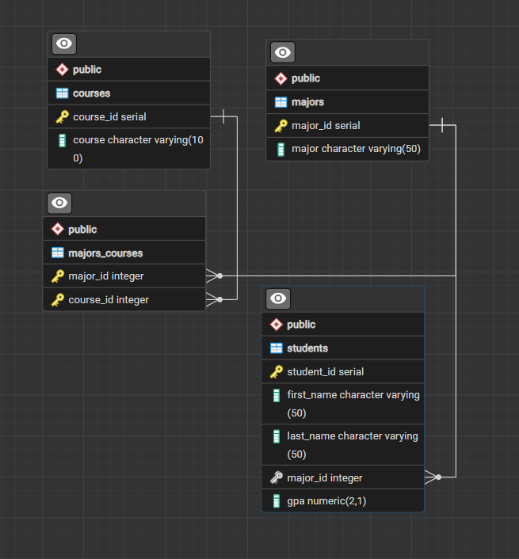

# Student Database — Part 1


**freeCodeCamp | Relational Database Certification**

**Chapter:** SQL and Bash  
**Workshop 1:** Build a Student Database: Part 1

A guided freeCodeCamp workshop focused on building and populating a PostgreSQL relational database using SQL, Bash scripting, and CSV data.

## Technologies

- PostgreSQL & SQL
- Bash scripting
- Git & GitHub
- GitHub Codespaces (Linux)
- pgAdmin 4

## Database Structure

The database contains four related tables:

| Table | Description |
|---|---|
| `students` | Student information, assigned majors, and GPA |
| `majors` | Available academic majors |
| `courses` | Available courses |
| `majors_courses` | Junction table connecting majors and courses |

The `majors_courses` table implements a many-to-many relationship between majors and courses.

### Entity Relationship Diagram



## Bash Script — Data Import

The `insert_data.sh` script automates importing data from two CSV files into PostgreSQL.

Using Bash loops, conditional statements, and SQL queries, the script:

- Reads student, major, and course information from CSV files.
- Checks whether majors and courses already exist.
- Inserts missing records into the database.
- Creates relationships between majors and courses.
- Associates students with their majors, including handling missing major values.

## PostgreSQL Database Dump

The original database dump was generated in the freeCodeCamp Linux Codespace using:

```bash
pg_dump --clean --create --inserts --username=freecodecamp students > students.sql
```

**Database files:**

- `students.sql` — Original PostgreSQL 12 dump generated in Codespaces.
- `students_local.sql` — Adapted SQL dump for restoring into an existing PostgreSQL 18 database on Windows.

The local version removes database deletion and creation statements and uses the local `postgres` role.

## Local Setup

1. Install PostgreSQL and create an empty database named `students`.
2. Connect to the database using pgAdmin 4.
3. Open `students_local.sql` in the Query Tool.
4. Execute the SQL script to restore the tables, data, sequences, and constraints.
5. Verify the restored database using SQL queries.

## Additional Work

Beyond the guided workshop, I:

- Exported the database from the Linux Codespace.
- Adapted the SQL dump for PostgreSQL 18 on Windows.
- Successfully restored and verified the database locally.
- Generated an Entity Relationship Diagram using pgAdmin.
- Version-controlled the project using Git and published it on GitHub.

---

*Educational workshop completed as part of freeCodeCamp's Relational Database Certification.*